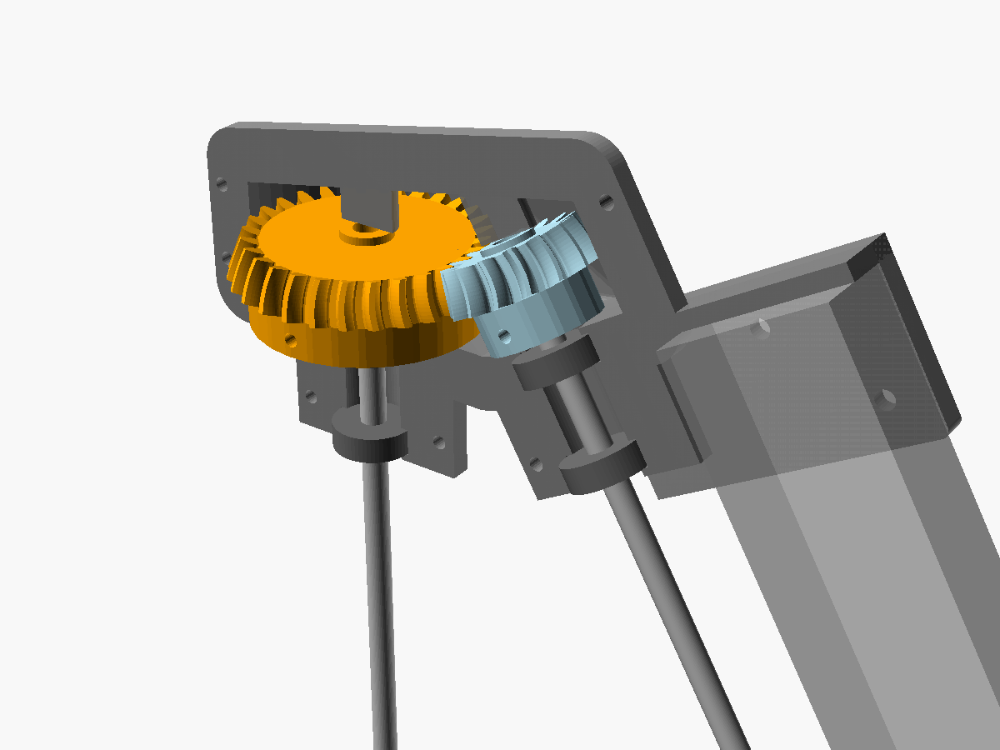
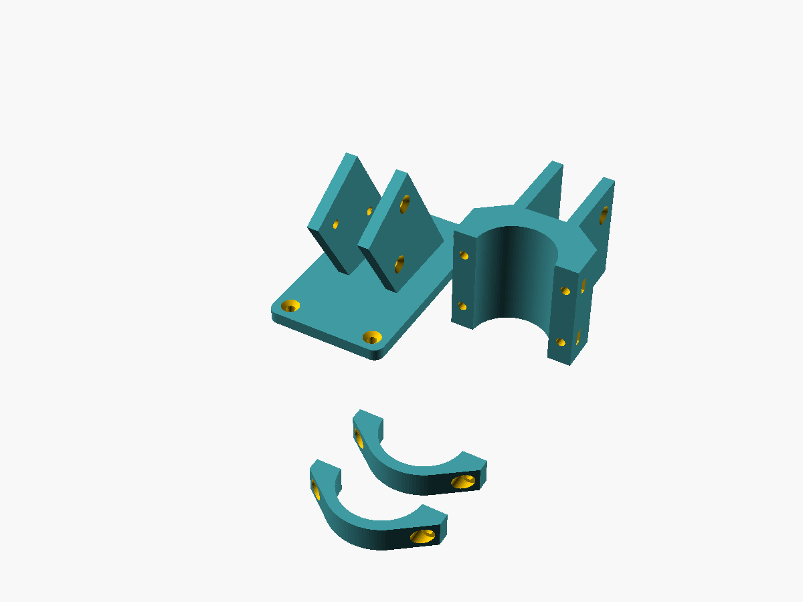
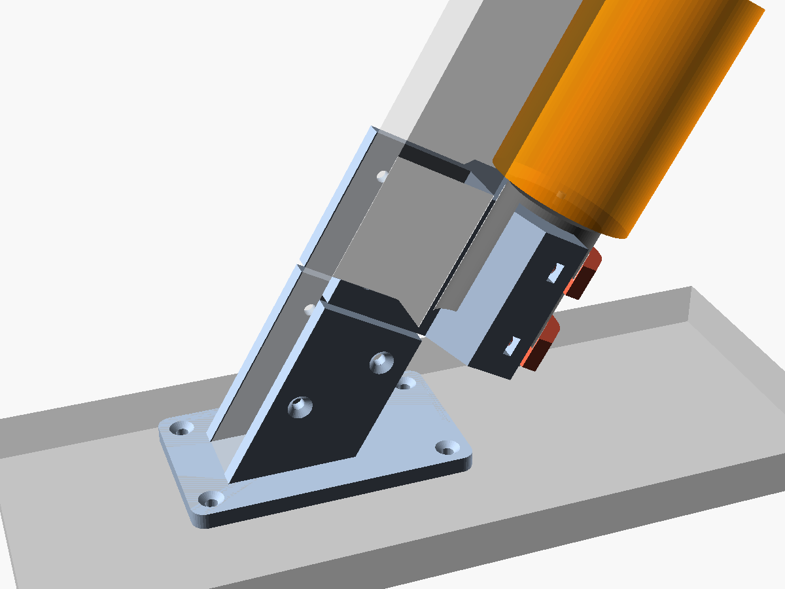

# Pot stirring unit

A 3D-printed automatic stirrer for a pot on the stove. The motor sits **beside**
the pot, so nothing but a small gearbox and the stirring shaft is above the food.



## How it works

```
                 ┌──────────── gearbox (bevel gears, 2 bearings per shaft)
                 │      ╲  ╲
                 │       ╲  ╲  wooden arm 20×40 on edge = the spine
   output shaft  │        ╲  ╲
   (stainless)   │  input  ╲  ╲
                 │  rod 30° [chuck]
                 │           [motor]═╡ cradle screwed to the arm
        ┌────────┴────┐            ╲╲
        │   paddle    │           [foot]  ← holds the arm at 60°
        └─── pot ─────┘   ─────────────── board next to the stove
```

1. **Wooden arm:** 20×40 mm, standing on edge (the 40 mm side in the bending plane).
   It is the spine of the whole unit: a printed **foot** holds its bottom end on the
   board at 60°, and the motor cradle and the gearbox both grip it.
2. **Motor:** TOPOWER 550-18V (RS-550 class, Ø38 mm), in a printed cradle that hangs
   under the arm, on the same axis as the gearbox input.
3. **Drill chuck:** on the motor shaft (Ø55 mm at its thickest). It grips the 6 mm
   steel input rod directly. The arm sits 31.5 mm from the rod axis, so the spinning
   chuck clears it by 4 mm.
4. **Input rod:** goes up at 30° from vertical to the gearbox.
5. **Gearbox:** a straight bevel pair turns the tilted input into a vertical output
   (15T → 29T, about 1.93:1 reduction).
6. **Output shaft:** 6 mm stainless rod with a wooden paddle, straight down into the pot.

Because the motor and the gearbox are both positioned from the arm, they line up by
construction. The shared numbers (angle, arm size, chuck clearance, cheek and screw
pattern) live in `common.scad`.

## Gearbox – `angled_gearbox.scad`

| Closed housing | Print parts |
|---|---|
|  |  |

- Module 2, 15T pinion / 29T gear, 30° shaft angle, 0.2 backlash (BOSL2 `bevel_gear`).
- Each 6 mm shaft runs in two 626 bearings (6×19×6), 18 mm apart.
- The housing is split in the plane of both shafts and the two halves are bolted
  together with 6× M3. Print each half split face down.
- Each gear has a hub boss that stops 0.3 mm short of a pad on the housing wall, so
  the gears can't slide into the wall:

  

- Arm mount: each housing half has one flat cheek that sits against a side of the
  arm, with 2 countersunk wood screws per cheek. The screws on the two sides are
  staggered so they don't meet inside the 20 mm wood. A cap on top is the end stop,
  so the arm end carries the gearbox weight, not the screws. The arm is not boxed in.

**Hardware:** 4× 626 bearing (the lowest output bearing must be 626-2RS),
6 mm stainless rod, 2× M3 grub screw + nut, 6× M3×12 bolt + nut,
4× 4 mm countersunk wood screw (~20 mm), 2× 6 mm shaft collar.

## Motor mount – `motor_mount.scad`

| Side view | Print parts |
|---|---|
|  |  |



- **Cradle:** grips the arm with two cheeks (2 wood screws each, staggered, like the
  gearbox) and holds the motor underneath it with two clamp caps (4× M4, the nuts
  slide in from the side). Before you drive the screws, slide it along the arm to set
  how deep the chuck grips the rod.
- **Foot:** a plate screwed to the board (4 wood screws), with two cheeks holding the
  arm's bottom end at 60°. Cut the arm's end 30° off square so it sits flat on the plate.
- In the lowest cradle position, the motor terminals and clamps stay 15 mm above the board.

**Hardware:** 4× M4×20 socket head + 4× M4 nut, 8× 4 mm countersunk wood screw
(~20 mm, cheeks), 4× 4 mm countersunk wood screw (foot → board), optional 1 mm
rubber strip in the cradle.

## Printing

- **PETG / ASA / nylon only.** Not PLA: it is too close to heat and steam.
- Housing halves: split face down, supports touching the build plate only.
- Gears: flat back down, no supports, 4+ perimeters, 40%+ infill.
- Motor cradle: standing on its rear end face, no supports. Clamps on their ring
  face, foot plate down, no supports.
- Run the gears dry, with no grease, because they are above the food.
- All STLs are in [`stl/`](stl/). `stirrer.3mf` is an older slicer project; re-slice from `stl/`.

## Building from source

Requires [OpenSCAD](https://openscad.org) and [BOSL2](https://github.com/BelfrySCAD/BOSL2)
(for the gearbox), installed in your OpenSCAD libraries folder.

```bash
# export one part (see `part` at the top of each .scad for the options)
openscad -o stl/housing_a.stl -D 'part="housing_a"' angled_gearbox.scad
openscad -o stl/motor_cradle.stl -D 'part="cradle"' motor_mount.scad
# regenerate all images in this README (needs xvfb-run when run headless)
./render_images.sh
```

## Status / open items

- [x] Gearbox v4: includes fixes from earlier test prints (looser bearing pockets, axial stops)
- [x] Arm 20×40 on edge, gripped by cheeks (gearbox, motor cradle, foot)
- [x] Motor mount on the arm, with clearance for the drill chuck
- [ ] Print and test gearbox v4 and the motor mount
- [ ] Measure the real chuck length (the model assumes 90 mm)
- [ ] Wooden paddle
- [ ] Full-unit assembly model (gearbox + arm + motor mount)
