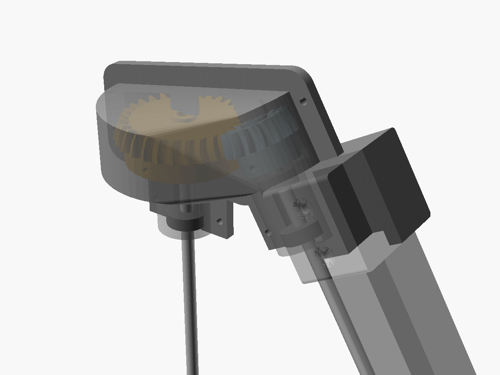
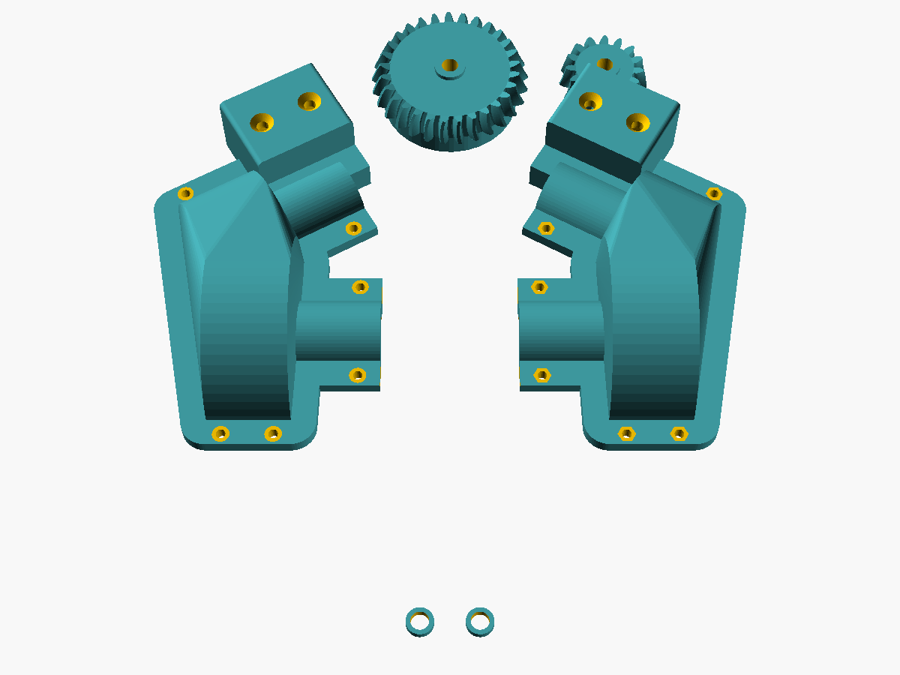
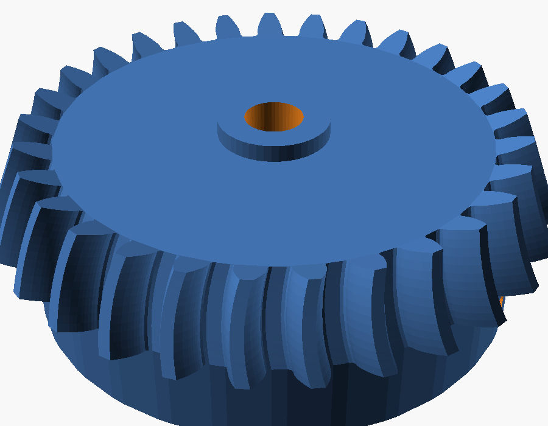
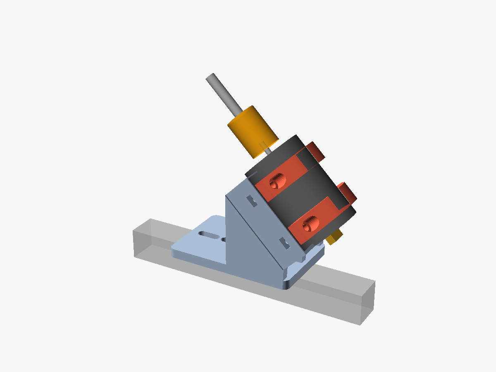

# Pot stirring unit

A 3D-printed automatic stirrer for a pot on the stove. The motor sits **beside**
the pot, so nothing but a small gearbox and the stirring shaft is above the food.


## How it works

```
                 ┌──────────── gearbox (bevel gears, 2 bearings per shaft)
                 │      ╲
                 │       ╲  input rod, 30° from vertical
   output shaft  │        ╲  + wooden arm 40×20 beside it (holds the gearbox)
   (stainless)   │         ╲
                 │          ╲
        ┌────────┴────┐   [motor]  ← RS-550 in a printed cradle
        │   paddle    │   ───────── board next to the stove
        └─── pot ─────┘
```

1. **Motor:** TOPOWER 550-18V (RS-550 class, Ø38 mm), clamped in a printed cradle on a board.
2. **Flexible coupler:** connects the 3.175 mm motor shaft to a 6 mm steel input rod.
3. **Input rod:** goes up at 30° from vertical to the gearbox.
4. **Wooden arm:** 40×20 mm, runs parallel to the rod. It slides into a socket on the
   gearbox and is the only thing holding the gearbox above the pot.
5. **Gearbox:** a straight bevel pair turns the tilted input into a vertical output
   (15T → 29T, about 1.93:1 reduction).
6. **Output shaft:** 6 mm stainless rod with a wooden paddle, straight down into the pot.

## Gearbox – `angled_gearbox.scad`

| Closed housing | Print parts |
|---|---|
|  |  |

- Module 2, 15T pinion / 29T gear, 30° shaft angle, 0.2 backlash (BOSL2 `bevel_gear`).
- Each 6 mm shaft runs in two 626 bearings (6×19×6), 18 mm apart.
- The housing is split in the plane of both shafts and the two halves are bolted
  together with 6× M3. Print each half split face down.
- Each gear has a hub boss that stops 0.3 mm short of a pad on the housing wall, so
  the gears can't slide into the wall:

  

- The arm socket takes a 40×20 wooden arm, fixed with 4 countersunk wood screws.

**Hardware:** 4× 626 bearing (the lowest output bearing must be 626-2RS),
6 mm stainless rod, 2× M3 grub screw + nut, 6× M3×12 bolt + nut,
4× 4 mm countersunk wood screw (~25 mm), 2× 6 mm shaft collar, flexible coupler.

## Motor mount – `motor_mount_45.scad`

| Assembly | Print parts |
|---|---|
|  |  |

A cradle with two clamp caps (4× M4 bolts, the nuts slide in from the side) and a
base plate with adjustment slots. It is still at a 45° tilt. A 30° input needs 60°
on a horizontal board, or the cradle could mount directly on the wooden arm.
That choice is still open.

## Printing

- **PETG / ASA / nylon only.** Not PLA: it is too close to heat and steam.
- Housing halves: split face down, supports touching the build plate only.
- Gears: flat back down, no supports, 4+ perimeters, 40%+ infill.
- Run the gears dry, with no grease, because they are above the food.
- Ready-made STLs for the gearbox are in [`stl/`](stl/). `stirrer.3mf` is a slicer project.

## Building from source

Requires [OpenSCAD](https://openscad.org) and [BOSL2](https://github.com/BelfrySCAD/BOSL2)
(for the gearbox), installed in your OpenSCAD libraries folder.

```bash
# export one part (see `part` at the top of each .scad for the options)
openscad -o stl/housing_a.stl -D 'part="housing_a"' angled_gearbox.scad
# regenerate all images in this README (needs xvfb-run when run headless)
./render_images.sh
```

## Status / open items

- [x] Gearbox v4: includes fixes from earlier test prints (looser bearing pockets, axial stops)
- [ ] Print and test gearbox v4
- [ ] Motor mount: re-tilt to 60° or mount it on the arm
- [ ] Flexible coupler (3.175 → 6 mm)
- [ ] Wooden paddle
- [ ] Full-unit assembly model (gearbox + arm + motor mount)
